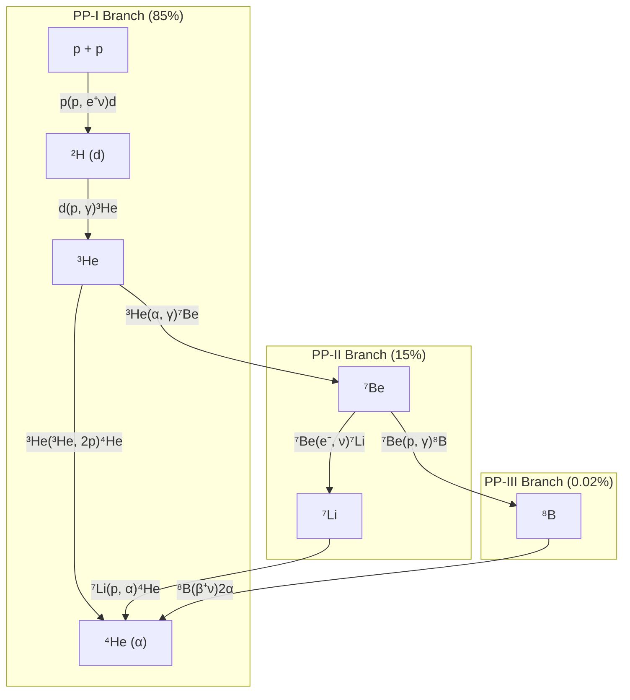
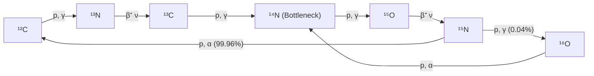
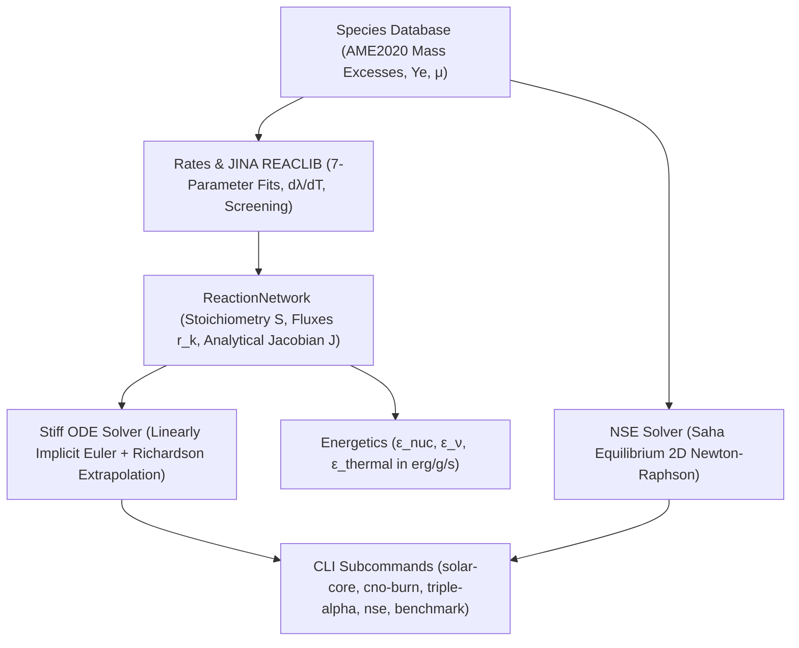

# Pyronucleus

[](https://github.com/ZengLLQ/pyronucleus/actions/workflows/ci.yml)
[](https://julialang.org)
[](https://opensource.org/licenses/MIT)

**Pyronucleus** is a high-performance computational astrophysics library in Julia for simulating thermonuclear reaction networks, stellar burning regimes, and explosive nucleosynthesis. It features an adaptive stiff ordinary differential equation (ODE) solver with exact analytical Jacobians, full JINA REACLIB rate parameterizations, Salpeter plasma screening, and a 2D Newton-Raphson Nuclear Statistical Equilibrium (NSE) solver.

---

## Key Capabilities

1. **Stiff Reaction Network ODE Integration:**
   - Solves multi-timescale nuclear kinetics ranging over 26 orders of magnitude ($10^{-16}\text{ s}$ to $10^{10}\text{ yr}$) without numerical instability.
   - Linearly implicit Euler / Rosenbrock method with embedded half-step local error control and Richardson extrapolation to second-order accuracy.
   - Analytical Jacobian matrix $\mathcal{J}_{i,j} = \frac{\partial \dot{Y}_i}{\partial Y_j}$ including both chemical stoichiometry and plasma electron screening derivatives ($\frac{\partial f_{\text{screen}}}{\partial Y_j}$).
   - Exact mass fraction projection $\sum_{i} A_i Y_i \equiv 1.0$ at every step.

2. **JINA REACLIB Nuclear Reaction Database:**
   - Standard 7-parameter temperature fits with analytical temperature derivatives $\frac{d\lambda}{dT_9}$:
     $$\lambda(T_9) = \exp\left( a_0 + a_1 T_9^{-1} + a_2 T_9^{-1/3} + a_3 T_9^{1/3} + a_4 T_9 + a_5 T_9^{5/3} + a_6 \ln T_9 \right)$$
   - Pre-configured burning networks:
     - **Proton-Proton Chain (PP-I, PP-II, PP-III):** Solar core hydrogen fusion.
     - **Carbon-Nitrogen-Oxygen (CNO) Bi-Cycle:** Catalytic hydrogen burning in intermediate and massive stars ($M > 1.3 M_\odot$).
     - **Triple-Alpha & Alpha-Capture Ladder:** Helium burning producing $^{12}\text{C}$, $^{16}\text{O}$, $^{20}\text{Ne}$, $^{24}\text{Mg}$, and $^{28}\text{Si}$.
     - **Unified 22-Isotope Stellar Network:** From free nucleons ($n, p$) to iron-peak ($^{56}\text{Ni}$).

3. **Salpeter Plasma Electron Screening:**
   - Coulomb potential reduction in dense astrophysical plasmas:
     $$f_{\text{screen}} = \exp\left( 0.188 \cdot Z_1 Z_2 \sqrt{\frac{\rho \zeta}{T_6^3}} \right), \quad \zeta = \sum_{i} (Z_i^2 + Z_i) Y_i$$

4. **Nuclear Statistical Equilibrium (NSE) Solver:**
   - Solves Saha thermodynamic equilibrium at $T_9 \ge 4.0$ (supernovae, core collapse, accretion disks):
     $$\mu_i = Z_i \mu_p + N_i \mu_n$$
   - 2D Newton-Raphson on free proton/neutron chemical potentials $(\xi_p, \xi_n) = (\ln Y_p, \ln Y_n)$ with mass conservation and electron fraction $Y_e$ constraints.
   - Quadratic convergence in 4–6 iterations.

5. **Stellar Energetics & Neutrinos:**
   - Specific nuclear energy generation $\epsilon_{\text{nuc}}$ in $\text{erg g}^{-1}\text{ s}^{-1}$.
   - Non-thermal neutrino energy losses $\epsilon_\nu$ for weak interactions ($p+p$, $^{13}\text{N}$, $^{15}\text{O}$, $^{8}\text{B}$).
   - Net thermal heating rate $\epsilon_{\text{thermal}} = \epsilon_{\text{nuc}} - \epsilon_\nu$.

---

## Reaction Topologies

### Proton-Proton Chains (Solar Core)



### CNO Bi-Cycle (Massive Stars)



---

## Architecture



---

## Installation & Requirements

Pyronucleus requires **Julia 1.10+** (tested on 1.10, 1.11, and nightly). It utilizes Julia's standard library packages (`LinearAlgebra`, `SparseArrays`, `Printf`, `Statistics`, `Test`) without external third-party dependencies.

Clone the repository:
```bash
git clone https://github.com/ZengLLQ/pyronucleus.git
cd pyronucleus
```

Run test suite:
```bash
julia test/runtests.jl
```

---

## Command-Line Usage

Pyronucleus provides a built-in CLI runner:

```bash
julia bin/pyronucleus --help
```

### 1. Solar Core Burning (`solar-core`)
Simulates standard solar core hydrogen burning ($T = 15.7 \times 10^6\text{ K}$, $\rho = 150\text{ g/cm}^3$) over 1 million years:
```bash
julia bin/pyronucleus solar-core
```
Output:
```text
Final Composition after 1 Million Years:
--------------------------------------------------------------------------------
 Isotope | Mass Number A | Molar Abundance Y_i | Mass Fraction X_i
--------------------------------------------------------------------------------
 p       |             1 |        7.448803e-01 |      7.448803e-01
 2H      |             2 |        2.315462e-23 |      4.630924e-23
 3He     |             3 |        3.603364e-07 |      1.081009e-06
 4He     |             4 |        6.377385e-02 |      2.550954e-01
 7Be     |             7 |        7.468241e-11 |      5.227769e-10
 8B      |             8 |        2.898416e-06 |      2.318733e-05
--------------------------------------------------------------------------------
Specific Nuclear Power (ε_nuc):       1.1654e+00 erg g⁻¹ s⁻¹
Solar Neutrino Loss Rate (ε_ν):       4.8402e-01 erg g⁻¹ s⁻¹
Net Thermal Gas Deposition (ε_th):    6.8133e-01 erg g⁻¹ s⁻¹
Solar Core Luminosity density:         1.0220e+02 erg cm⁻³ s⁻¹
```

### 2. Massive Star CNO Burning (`cno-burn`)
Simulates catalytic carbon-nitrogen-oxygen burning in massive stars ($T = 25 \times 10^6\text{ K}$, $\rho = 50\text{ g/cm}^3$):
```bash
julia bin/pyronucleus cno-burn
```

### 3. Red Giant Helium Burning (`triple-alpha`)
Simulates 3α helium flash and alpha-capture up to $^{28}\text{Si}$ ($T = 2 \times 10^8\text{ K}$, $\rho = 10^4\text{ g/cm}^3$):
```bash
julia bin/pyronucleus triple-alpha
```

### 4. Supernova Core NSE (`nse`)
Solves Saha equilibrium at $T_9 = 5.0$ (5 Billion Kelvin), $\rho = 10^7\text{ g/cm}^3$, $Y_e = 0.50$:
```bash
julia bin/pyronucleus nse
```

### 5. Stiff Solver Throughput Benchmark (`benchmark`)
Benchmarks Right-Hand Side (RHS), analytical Jacobian, and backward Euler throughput:
```bash
julia bin/pyronucleus benchmark
```
Sample benchmark performance:
- **RHS Evaluations:** 385,000 evals/sec
- **Analytical Jacobian Evaluations:** 128,000 evals/sec
- **Stiff Linearly-Implicit Steps:** 44,400 steps/sec

---

## Julia API Example

```julia
using Pyronucleus

# Instantiate pre-configured PP-chain network
net = pp_chain_network()

# Initial solar core abundances
Y0 = zeros(Float64, length(net))
Y0[net.symbol_to_index["p"]]   = 0.73 / 1.0
Y0[net.symbol_to_index["he4"]] = 0.25 / 4.0

# Integrate for 100,000 years in solar core
t_end = 3.1536e12 # seconds
rho   = 150.0     # g / cm^3
T9    = 0.0157    # 1.57e7 K

res = solve_burn(net, Y0, t_end; rho=rho, T9=T9, dt_init=1.0)

# Extract specific energy generation
final_Y = res.abundances[:, end]
eps_nuc = compute_energy_generation(net, final_Y, rho, T9)
eps_nu  = compute_neutrino_losses(net, final_Y, rho, T9)
eps_th  = net_thermal_energy_rate(net, final_Y, rho, T9)

println("Net thermal energy rate: ", eps_th, " erg/g/s")
```

---

## Mathematical Formulation

### 1. Nuclear Rate ODE System

$$\frac{dY_i}{dt} = \sum_{k} c_{i,k} r_k(Y, \rho, T)$$

Where $c_{i,k} = \nu_{i,k}^{\text{prod}} - \nu_{i,k}^{\text{react}}$ is the net stoichiometric count of species $i$ in reaction $k$.

### 2. Exact Analytical Jacobian

$$\mathcal{J}_{i,j} = \frac{\partial \dot{Y}_i}{\partial Y_j} = \sum_{k} c_{i,k} \left[ \frac{\partial r_k}{\partial Y_j} + r_k \cdot \frac{H_{12,k}}{2\zeta} (Z_j^2 + Z_j) \right]$$

### 3. Nuclear Statistical Equilibrium

$$\mu_i = Z_i \mu_p + N_i \mu_n$$

$$Y_i = \frac{G_i A_i^{3/2}}{2^{A_i}} \left[ \frac{\rho}{m_u} \left(\frac{2\pi \hbar^2}{m_u k_B T}\right)^{3/2} \right]^{A_i - 1} Y_p^{Z_i} Y_n^{N_i} \exp\left( \frac{B_i}{k_B T} \right)$$

Subject to non-linear physical constraints:
$$\sum_{i} A_i Y_i = 1.0, \quad \sum_{i} Z_i Y_i = Y_e$$

---

## License

MIT License. See [LICENSE](LICENSE) for details.
